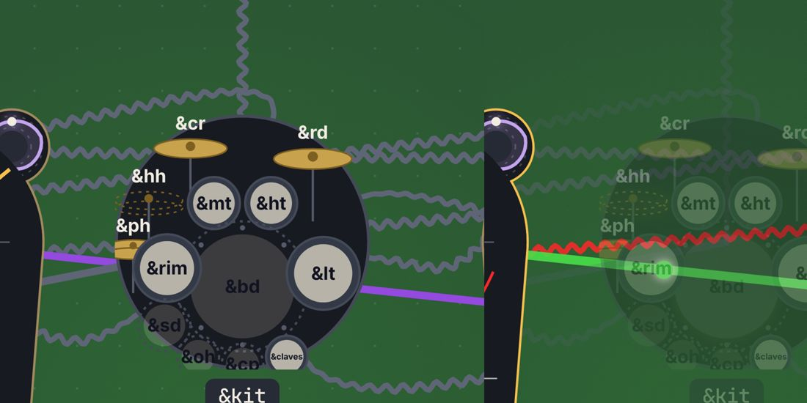

# What sounds: the implicit `&out`, MIDI cards, what an out is, what has a spire

Date: 2026-10-30 · Status: open (a deep-dive and a proposal, for the owner's ruling) · Issue: [#380](https://github.com/yggi/cells/issues/380) · Bug found on the way: [#379](https://github.com/yggi/cells/issues/379) · Cell studio's half: [yggi/cell-studio#523](https://github.com/yggi/cell-studio/issues/523)

## The ask

Pull tight around one question: what sounds and what doesn't. That covers the implicit `&out` (the built-in card, [decision 028](../decisions/028-the-smallest-piece.md)), MIDI cards as voices ([019](../decisions/019-midi-card.md); Cell studio's [039](https://github.com/yggi/cell-studio/blob/main/docs/decisions/039-midi-cards-heard.md)), and what has a spire in Cell studio's tower view. It is a generalisation and subtraction round: do more with less.

## What exists

### "Is this heard?": six places, four answers

| where | the rule | a voice only on a MIDI card |
|---|---|---|
| compile, `compiler/builtin.ts` (028) | with no card of either kind written, a built-in card hears every sound (sort signal or wave, `compiler/sorts.ts`) that nothing reads, nor a `use` gave | n/a: any MIDI card suppresses the built-in card (028's text says "no sound card") |
| realize, `unheard` (`realize.ts`, 019) | heard iff it reaches a sound card with a gain | not heard |
| routing, `route()` (`routing.ts`): what a frontend lights | routed iff it reaches a sound card or a MIDI card | **lit as sounding**. Cell studio's 039 and yggi/cell-studio#478 say the opposite, and are stale |
| the renderer, `heardVoices` and `unheard` (`render.ts`, [062](../decisions/062-cells-renders-audio.md)) | as realize | silent |
| Cell studio's voices, `heardHere` (039) | heard on either card, at its entry's gain | heard |
| Cell studio's tower, `cards()`, `towerOuts`, `withSockets` | a socket per edge into a sound card | no socket, no spire, no lane |

So `midi-out`'s `&sub` is heard in Cell studio, lit by the routing, silent in a render, and without an out in the tower. A followed Jambot session (every note on one MIDI card) is heard everywhere in Cell studio and has no out at all in its tower.

### "What is one out?": four units

| where | an out is |
|---|---|
| the renderer's stems (`tracks: 'entries'`, 062) | a card's entry: a term of its mix, `Output.parts[].entry` (channel, place, label) |
| a MIDI card (019) | an entry: a channel |
| Cell studio's socket, spire and strip lane | an edge into the sound card: a gate's voices one each ([Cell studio 022](https://github.com/yggi/cell-studio/blob/main/docs/decisions/022-gates-send-notes.md)), a kit one, a tape's read head one, the built-in card one per unread sound (`withCard` re-parses the built-in card's mix to find them) |
| Jambot | a part, played by a performer ([058](../decisions/058-the-performer-is-a-gate.md), [061](../decisions/061-the-band.md)) |

Over the 81 examples, the sockets a piece draws and its card's entries differ in 18 pieces, both ways (a scratch probe over `writtenGraph` and `Output.parts`):
- A voice in several terms gives more entries: `pachelbel` 2 sockets against 6 entries, `echotape` 2 against 6, `cellscape2` 6 against 10.
- A term whose gate, mix, tape or resonator sounds several voices gives more sockets: `resonanz` 5 against 2, `soundtape` 4 against 2, `testtones` 4 against 2.

### Kits: three cells can be "the kit"

- A table of voices (`&kit &bd &sd &hh`).
- The implicit `kit:voices` that a line naming its drums makes (`&bd ~ &sd`).
- A gate's `<gate>:kit`, made of several bare voices.

The graph's `gateVoices` takes a gate's receivers; the routing takes what the outputs play. In the drummer fragment (`&drumsOut play=&drumlines &kit`, its lines naming their drums) those differ: the graph wires `&kit → out`, the routing plays `kit:voices`. Cell studio draws the kit, its socket and its note bus `unrouted` (dimmed) while the drums play (Electro swing, Spooky: [#379](https://github.com/yggi/cells/issues/379)):

(Cell studio, `ZOOM=kit node tools/gallery.mjs zoom 8 electroswing`. The drawn states: `node tools/gallery.mjs play 6 "Electro swing"`.)

A role cell (`&drums map=role &drumsOut`, 061) is never routed either, so it is dimmed whenever its gates play. In every other example, an unrouted node is one nothing plays (`waveforms`' alternatives, `in-c`'s `&pulse`, `fifths`' `&circle`), or a structural input read only as a tonic.

### Sorts: known to the compiler, re-derived by the frontend

`compiler/sorts.ts` types every cell (signal, wave, pitch, volume, plain), and the built-in card uses that. `ResolvedCell` doesn't carry it, so Cell studio re-derives:
- maker, gate and mixer from flags (`soundRole`, `layout/sound.ts`);
- a kit's voices from `over=` (`voicesOf`, `ui/heard.ts`);
- a kit's height from its members' pitch or filter (`socketHeights`, `layout/towerlayout.ts`).

## The proposal (#380)

1. **Heard on either card** ([#333](https://github.com/yggi/cells/issues/333), as the owner ruled on 2026-10-27). A note is heard iff it reaches an entry that is on, on a sound card or a MIDI card, at the entry's gain. `unheard` means silent gains only. Realize, the renderer, the routing and Cell studio agree; 039's override and `heardHere` go.
2. **The built-in card is the card a piece gets when it writes no sound card**, as 028 says (the code says no card of either kind). Open: does a piece with only a MIDI card also hear its unread sounds through it? (Yes, by 028's words.)
3. **An out is a card's entry, on either card**: one unit for a stem, a channel, a performer's part and a socket. Cells gives `outs(result, muted)`: each entry with its card and kind, its channel, place and label, the voices that sound in it (gates and kits resolved as the outputs play them), its base frequency, and whether it is heard. The built-in card's entries come from it too.
4. **The routing and the graph from one traversal starting at the outs.** A gate's drawn voices are those its outputs play (#379 by construction). A table that names sounds (a kit, a role cell, a band) is routed while a member is. `writtenGraph(result, { card: true })` includes the built-in card's node, so no frontend adds it.
5. **`ResolvedCell.sort`, and the sound role once** (maker, gate, mixer, card, none): the frontends read it.

**MIDI cards as voices.** Under (3) a MIDI entry is an out like a sound card's. A frontend that sounds it draws it as one: a socket, a spire, a lane, marked with its channel. The MIDI card's node at the foot of the structure goes, as the sound card's did in the tower layout. The alternative, a MIDI entry as a voice in the voices' stratum (an external instrument) with a socket over it, draws more and says the same. Recommended: (3).

**What has a spire**, then: every out, and only outs. Whatever a card's entry sounds stands as one socket at the entry's base frequency, its voices' wires joining there, and its spire the sum of what they sound (`heard()` already sums a kit's drums). One strip lane per out, the same unit as the stems a render makes.

## What goes

- **In cells:**
  - `heardVoices` and the MIDI half of `unheard` (1);
  - a drummer's second kit (#379);
  - the graph's `soundsOf` and `gateVoices` beside the routing's (4).
- **In Cell studio** ([yggi/cell-studio#523](https://github.com/yggi/cell-studio/issues/523)):
  - `withCard` and `heardBy`, `soundRole`'s rules, `cards()`, `voicesOf`, `socketHeights`' kit heuristics;
  - `heardHere` and 039's override.

## Rungs

1. #333: heard on either card (amends 019). #273 is rewritten on it.
2. #379: one kit, tables lit with their members (drawing only; no snapshot moves).
3. `outs()`, `ResolvedCell.sort` and the sound role, tested over every example's entries and the built-in card's.
4. The routing and the graph from `outs()`; the built-in card's node on request.
5. Cell studio moves its pin and subtracts (yggi/cell-studio#523).

## The issues, consolidated (2026-10-30)

- **Filed:**
  - #379 (the kit bug);
  - #380 (this model);
  - yggi/cell-studio#523 (what has a spire; a MIDI-only voice's missing out).
- **Closed:** yggi/cell-studio#440 (all rungs merged) and #416 (held by #440, #445 and #448).
- **Corrected:** #333 and yggi/cell-studio#478. The routing already lights a MIDI-only voice.
- **Held, in this model's terms:**
  - #10: a drum voice that is only its MIDI note. Under (1) and (3) it still has nothing to sound here, and #354's rig may dissolve its motive.
  - #273: S1 and MIDI.
  - #315: stems by entry.
  - #318 and #342: a spliced line of hits, one root, to fix together.
  - #327: who owns the routing; this keeps it in cells.
  - #354: the rig's cards.
  - yggi/cell-studio#309: the flow layout's sockets, which take the same outs.
